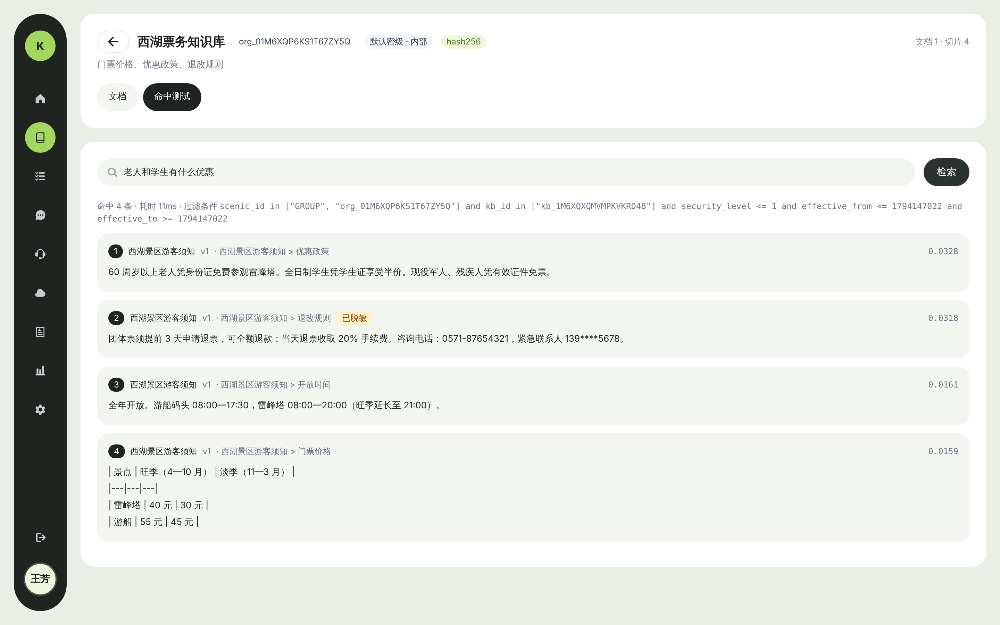

# pd_knowledge_service

PDK 知识服务：知识库 · 检索 · 知识更新（Python）

所有知识类文档经 MinerU 解析、切片，存入 Milvus 向量库，通过 PDA（hermes-agent，对应客户架构中的 PAP 智能体平台）对外提供问答；权限由 PDS 统一控制。

> 当前为**工程骨架**：分层结构、PDS 鉴权对接、接入流水线（解析 → 切片 → 向量化 → 审核 → 发布）、混合检索与权限过滤、MCP、PDA 网关与 hermes 插件、管理后台框架均已可运行；
> 数据源、评测、统计、智能助手配置、治理台等模块按《产品功能文档》逐步实现，管理后台页面按 UX Pilot 设计稿完善。



## 快速开始（零依赖开发模式）

需要 Python 3.11+、[uv](https://docs.astral.sh/uv/)、Node 20+ 与 pnpm。默认使用 SQLite、本地目录、内存向量库与哈希向量（无语义，仅调试），不连接 PDS。

```bash
make install
```

```bash
cp .env.example .env
```

```bash
make dev
```

```bash
make web
```

打开 http://127.0.0.1:5175 。开发模式下所有请求视为请求头 `X-Dev-User`（默认 `dev_admin`）、景区 `X-Dev-Scenic`（默认 `S001`），拥有全部权限；`PDK_ENV=prod` 时禁止开发模式。

接口文档：http://127.0.0.1:8000/docs

## 接入 PDS

1. PDS 本地启动（`--spring.profiles.active=local`）已内置客户端：`pdk-console`（管理后台登录，回调 `http://127.0.0.1:8000/auth/callback`）、`pdk-service`（服务账号）、`pda-gateway`、`pda-plugin`。
2. `.env` 中设置 `PDK_AUTH_MODE=pds`、`PDK_SYNC_MANIFEST_ON_STARTUP=true`，启动时自动把 PDK 权限清单提交到 PDS（也可 `pdk sync-manifest`）。
3. 在 PDS 中把 PDK 权限点授予角色/人员；新建知识库时 PDK 把它注册为资源实例 `pdk:kb:{id}`，**创建人作为负责人默认拥有管理权**，其他人的查看/编辑权限在 PDS（或 PDK 知识库“授权”接口）中授予。
4. 管理后台登录走 BFF：浏览器 → `/auth/login` → PDS 统一登录 → `/auth/callback` → HttpOnly Cookie；浏览器不接触令牌。

鉴权要点：

| 能力 | 实现 |
|---|---|
| 身份 | 会话 Cookie / `Bearer` PDS 令牌或令牌交换票据（aud=pdk）/ `X-PDK-Api-Key` 接口密钥（+ 可选 `X-PDS-User-Ticket`） |
| 权限快照 | 缓存 5 分钟；令牌 `authz_ver` 变大立即刷新；PDS Webhook 事件按人员或全部失效 |
| PDS 不可用 | 未过期快照照常；过期快照在宽限期内只读降级；没有快照则拒绝，不默认放行 |
| 检索权限 | 检索**前**生成过滤条件：景区（+GROUP）、可读知识库、最高密级、生效期；请求参数只能缩小范围 |
| 数据库景区隔离 | 带 `scenic_id` 的表查询自动追加景区条件；后台任务必须显式 `system_scope(原因)` |
| 脱敏 | 切片识别手机号/身份证/银行卡/邮箱/车牌，检索返回时掩码，原文不改 |
| 审计 | 上传、下载、检索、授权、管理操作批量上报 PDS 审计中心；失败落盘重传 |

## 代码结构

```
pdk/
├── main.py               # pdk-api 入口（REST + /mcp + 管理后台静态资源）
├── config.py             # 全部配置（环境变量 PDK_*）
├── core/                 # 统一响应、错误码、trace_id、缓存、ID、日志
├── auth/                 # PDS 客户端、JWKS 验签、权限快照、BFF 会话、鉴权依赖、权限清单
├── db/                   # SQLAlchemy 模型、会话、景区隔离钩子
├── storage/              # 对象存储（本地/S3）、向量库（内存/Milvus）
├── parsers/              # 解析器接口；纯文本 / MinerU 适配器
├── chunking/             # 按结构 / 定长 / FAQ 切片
├── enrich/               # 清洗、敏感信息识别与脱敏
├── ai/                   # 嵌入（哈希/OpenAI 兼容）、重排（无/HTTP）
├── ingest/               # LangGraph 流水线：parse → chunk → index →（审核）→ publish；增量比对
├── retrieval/            # 权限过滤表达式、混合检索服务
├── services/             # 审计上报、接口密钥、PDS 同步
├── api/routers/          # 知识库、文档、切片、审核、检索、工单、任务、密钥、统计、PDS 事件、治理台
├── mcp/                  # MCP Server（pdk_search、pdk_list_knowledge_bases）
└── workers/              # Celery（pdk.parse / pdk.embed 队列）
pda/
├── gateway/              # pda-gateway：登录、会话上下文、转发 hermes（SSE）、出站脱敏
├── hermes_plugins/       # pdk_tools（知识工具）、pds_guard（权限守卫/脱敏/审计）、pd_common
├── persona/SOUL.md       # 中文人设
├── skills/               # 中文业务技能
└── manifest.py           # PDA 权限清单
web/                      # 管理后台（Vue3 + View UI Plus + Tailwind，与 PDS 后台同一设计语言）
migrations/               # Alembic 迁移
deploy/docker-compose.yml # PostgreSQL / Redis / MinIO / Milvus / pdk-api / Worker / pda-gateway
tests/                    # pytest
```

## 生产部署

```bash
docker compose -f deploy/docker-compose.yml up -d
```

- 数据库：PostgreSQL，`alembic upgrade head`（compose 中的 `migrate` 服务）；开发时 SQLite 自动建表。
- 任务：`PDK_TASK_MODE=celery`，解析与向量化分队列独立扩容。
- 模型：`PDK_EMBED_PROVIDER=openai` 指向 bge-m3 推理服务（Xinference / TEI / vLLM），`PDK_RERANK_PROVIDER=http` 指向重排服务，`PDK_MINERU_URL` 指向 MinerU API。
- hermes-agent 按官方文档独立部署（API Server 模式），把 `pda/hermes_plugins/` 下三个目录拷贝到其插件目录，并按技术方案 §8.4 关闭高风险工具集。插件 API 名称以部署版本为准，开工第一周按 POC 清单（技术方案 §8.6）核对。

## 测试

```bash
make test
```

覆盖：开发模式端到端（上传 → 流水线 → 检索 → 新版本增量 → 下线）、PDS 鉴权（功能权限、知识库实例权限、跨景区、快照缓存与版本刷新、Webhook 验签与防重放、PDS 故障拒绝与只读降级）、接口密钥、MCP 工具调用、切片、脱敏、过滤表达式与防注入、MinerU 结果转换、hermes 插件守卫。设置 `PDK_TEST_DATABASE_URL` 可在 PostgreSQL 上运行。

## 文档

| 文档 | 说明 |
|---|---|
| [00-总体架构与PDA接入方案](docs/00-总体架构与PDA接入方案.md) | PDK / PDS / PDA 总体架构、与客户架构的对应关系、身份透传、权限点目录 |
| [01-PDK产品功能文档](docs/01-PDK产品功能文档.md) | 功能清单、问答门户、PDA 管理、数据模型、接口清单、验收要点 |
| [02-PDK技术方案](docs/02-PDK技术方案.md) | 技术选型、接入流水线、Milvus 设计、检索与权限过滤、hermes 插件、POC 清单、里程碑 |
| [03-PDK知识接入与治理台](docs/03-PDK知识接入与治理台.md) | 面向开发/运营的第二个后台：飞书/文件/链接/数据库接入、AI 标注（数据域/业务域）、复核质检、路由入库（功能+技术） |

相关仓库：[pd_centralized_permission](https://github.com/keanying/pd_centralized_permission)（PDS 统一权限）
