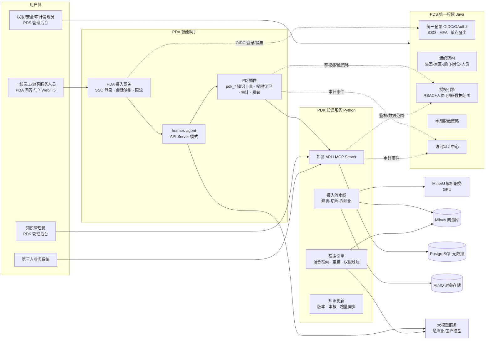
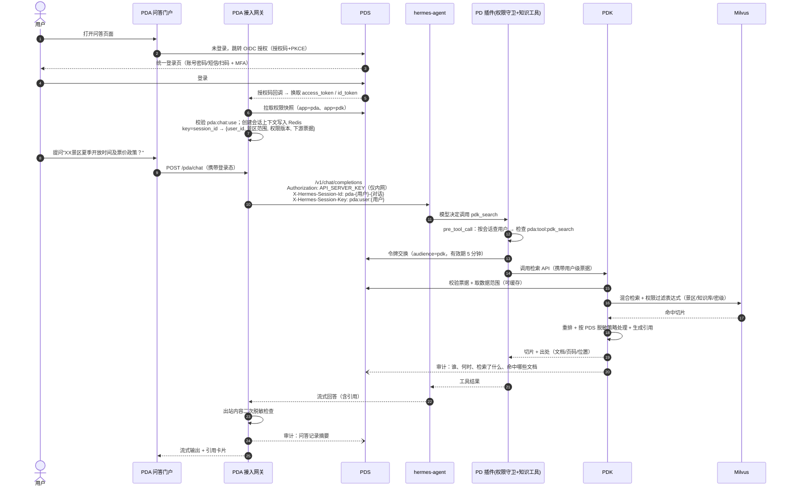
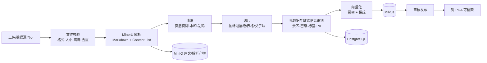

# PD 平台总体架构与 PDA 接入方案

> 适用范围：PDK 知识服务（本仓库）、PDS 统一权限（`keanying/pd_centralized_permission`）、PDA 智能助手（基于 hermes-agent）
> 文档状态：V0.1 草案（产品与架构设计，待评审）
> 本文在两个仓库中保持一致：`pd_knowledge_service/docs/00-总体架构与PDA接入方案.md` 与 `pd_centralized_permission/docs/00-总体架构与PDA接入方案.md`。

---

## 1. 建设目标

| 编号 | 目标 | 说明 |
|---|---|---|
| G1 | 知识统一沉淀 | 各类文档（PDF、扫描件、Word、PPT、Excel、网页等）统一经 **MinerU** 解析、切片、向量化，存入 **Milvus**，由 **PDK** 统一管理与检索 |
| G2 | 智能问答统一出口 | 知识对外输出统一通过 **PDA**（基于 hermes-agent 部署的智能助手），复用其工具调用、技能、记忆、子代理、定时任务等能力 |
| G3 | 统一身份与权限 | 所有人员通过 **PDS** 单点登录；PDS 按组织架构 + 人员明细权限，对 PDK 全部能力和 PDA 全部能力做权限控制，并提供景区隔离、字段脱敏、访问审计 |
| G4 | 三个系统独立部署、独立管理 | PDK（Python）、PDS（Java）、PDA（hermes-agent + 接入层）各自独立部署、独立升级，各自有管理后台；通过标准协议（OIDC / REST / 事件）对接，基础设施复用 PBS 公共底座 |
| G5 | 全中文 | 所有界面、提示词、回答、日志展示、文档均为中文 |
| G6 | 融入客户总体架构 | 与客户规划的 PDC/PDP/PDL/PDR、PBS 公共底座、回流闭环对齐，一期先自带最小能力，后续可无缝切换 |

## 1A. 与客户总体架构的对应关系

客户规划的数据与智能平台自下而上分为：数据来源 → PDC 数据集成 → 数据清洗（PDP 数据清洗 → PDL 智能标注 → PDR 审核质检）→ 实时治理 PDE / 离线治理 PDG → 数据出口（PDT 标签中心 · **PDK 知识服务** · PDD 数据服务）→ **PDS 统一权限**（横跨查数层与应用层）→ 查数层（PDQ 即席自助 · PBI 数易 BI · **PAP 智能体平台**）→ 应用层（票付通 3.0、景数通、数字大脑、畅游、各类 APP）；右侧为**回流闭环**（回流平台：问答与评价、审核修正、工单结果、使用热度 → 反哺业务：定价、营销、调度、指标与知识）；底部为 **PBS 公共底座**（API 网关、注册与配置、消息总线、任务编排、存储、监控告警、通知）。

本次建设的三个系统在该架构中的位置：

| 本方案 | 客户架构中的位置 | 说明 |
|---|---|---|
| **PDS** | PDS 统一权限 | 一致。除 PDK、PAP 外，后续还要服务 PDQ、PBI、PDT、PDD 及应用层，所以按**多应用通用**设计 |
| **PDK** | 数据出口层 · PDK 知识服务 | 一致。PDK 有两个后台：面向各景区知识管理员的"知识管理后台"，以及面向开发/运营的"知识接入与治理台"（飞书/文件/链接/数据库接入 → AI 标注到数据域、业务域 → 复核 → 路由入库）。客户架构中"企业知识"（Word/PDF/Excel/Markdown/图片/音视频）的解析、标注、审核原本属于 PDP/PDL/PDR。**一期这些平台尚未建成**，PDK 内置一条"知识专用清洗通道"（MinerU 解析 = PDP 能力，切片与 AI 打标 = PDL 能力，审核发布 = PDR 能力），按可替换模块设计，待 PDP/PDL/PDR 建成后切换为调用它们 |
| **PDA**（hermes-agent） | 查数层 · **PAP 智能体平台** | PDA 即 PAP 的智能体内核与知识问答出口。PAP 的"意图识别 · 流量分发 · 智能体管理"由 hermes 的模型路由、技能、子代理加上 PD 插件实现；问知识走 PDK 工具，问数据（后续）走 PDQ/PDD 工具 |
| 公共能力 | PBS 公共底座 | PDK/PDS/PDA 不自建基础设施：API 网关、配置中心、消息总线、任务编排、对象存储、监控告警、通知统一使用 PBS（PBS 未就绪时以同类开源组件临时替代，接口保持一致） |
| 反馈数据 | 回流平台 | PDA 的点赞/点踩/纠错、PDK 的审核修正与工单结果、知识使用热度，通过消息总线统一推送到回流平台 |

> 命名约定：下文 "PDA" 与 "PAP 智能体平台（hermes 内核）" 指同一系统。

## 2. 系统划分与命名

| 简称 | 全称 | 技术栈 | 仓库 | 职责 |
|---|---|---|---|---|
| **PDS** | PD 统一权限服务 | Java 21 + Spring Boot 3 + Spring Authorization Server | `keanying/pd_centralized_permission` | 统一登录、组织架构、角色授权、人员明细权限、景区隔离、字段脱敏、访问审计 |
| **PDK** | PD 知识服务 | Python 3.11+ + FastAPI + LangGraph | `keanying/pd_knowledge_service` | 知识库、文档接入、MinerU 解析、切片、向量化、检索、知识更新、对 PDA 提供知识工具 |
| **PDA** | PD 智能助手（客户架构中的 PAP 智能体平台） | hermes-agent（上游，不改源码）+ PD 插件 + PDA 接入网关 + 问答门户 | 接入代码建议放在 PDK 仓库 `pda/` 目录（也可后续拆为独立仓库） | 面向最终用户的问答入口，调用 PDK 知识工具回答问题 |

> 说明：hermes-agent 本身是"单用户个人助手"形态（一个 profile 对应一套记忆/技能/会话），对外的 OpenAI 兼容 API 只用一个静态 `API_SERVER_KEY` 鉴权，**没有企业多用户身份与权限概念**。因此 PDA = hermes-agent + 我们自建的"接入网关 + 权限插件"，由接入层补齐多用户、SSO、权限、审计能力，**不修改 hermes 源码**，便于跟随上游升级。

## 3. 总体架构

## 4. 参考项目的借鉴点

| 参考项目 | 在本方案中的用途 |
|---|---|
| [NousResearch/hermes-agent](https://github.com/NousResearch/hermes-agent) | PDA 的智能体内核：OpenAI 兼容 API Server（`/v1/chat/completions`、`/v1/responses`、`/v1/runs`）、插件机制（`register_tool` / `register_hook`）、`pre_tool_call` 钩子（可 block / approve / modify）、技能（Skills）、记忆、子代理、定时任务、MCP 客户端、`X-Hermes-Session-Id` / `X-Hermes-Session-Key` 会话与记忆隔离、多 profile |
| [opendatalab/MinerU](https://github.com/opendatalab/MinerU) | PDK 的文档解析引擎：PDF/图片/DOC(X)/PPT(X)/XLS(X)/RTF/OFD/EPUB/HTML/CSV 等；输出 Markdown 与结构化 Content List（含页码、版面块位置），用于切片与溯源高亮；支持 API 服务与多服务 Router |
| [datawhalechina/all-in-rag](https://github.com/datawhalechina/all-in-rag) | PDK 的 RAG 方法论：切片策略、向量嵌入、Milvus 使用与索引优化、混合检索、查询构建/改写、高级检索（重排、父子块）、格式化生成、系统评估、Agentic RAG |
| [langchain-ai/langgraph](https://github.com/langchain-ai/langgraph) | PDK 的流程编排：文档接入流水线、Agentic 检索流程，提供检查点、重试、断点续跑 |
| [langchain-ai/deepagents](https://github.com/langchain-ai/deepagents) | PDK 内部"知识整理 Agent"（批量摘要、问答对生成、知识冲突检测）的实现框架；子代理 + 人工审批（Human-in-the-loop） |
| [langchain-ai/openwiki](https://github.com/langchain-ai/openwiki) | 借鉴"知识事实可追溯到来源证据、只更新变化部分"的思路，用于 PDK 的增量更新与知识页（专题汇编）生成 |
| [langchain-ai/open-swe](https://github.com/langchain-ai/open-swe) | 借鉴异步长任务 Agent 的任务化、可观测、可审批设计，用于知识更新任务中心 |

## 5. 核心链路

### 5.1 用户登录并在 PDA 提问（端到端）

### 5.2 身份透传的关键设计（必须遵守）

1. **hermes 不接触用户凭证**：hermes 只拿到会话 ID，用户身份由接入网关写入 Redis 会话上下文，PD 插件在工具执行时通过 hermes 提供的会话上下文（`get_session_env("HERMES_SESSION_*")` / 钩子入参 `task_id`）反查。
2. **用户身份绝不来自模型参数**：PDK 只信任 PDS 签发的用户级票据，模型生成的任何 `user_id`、`kb_id` 参数都要再经过权限校验。
3. **知识工具用 hermes 原生插件工具实现**（`ctx.register_tool`，toolset=`pdk`），在工具处理函数内部完成换票和调用 PDK；PDK 同时提供标准 MCP Server 供其他智能体使用（MCP 场景使用服务账号 + 用户票据头）。
4. **所有工具调用前统一过权限守卫**：`pre_tool_call` 钩子对每次工具调用检查 `pda:tool:{工具名}`，无权限返回 `{"action":"block"}`；高风险工具返回 `{"action":"approve"}` 走人工审批。钩子超时/异常时 hermes 默认"失败即拒绝"，符合安全要求。
5. **记忆隔离**：`X-Hermes-Session-Key = pda:user:{userId}`，保证长期记忆按人隔离；对话记录按 `X-Hermes-Session-Id` 隔离。
6. **默认关闭高风险能力**：终端、文件读写、浏览器、代码执行、电脑操作等工具集在企业模式下默认关闭，只有获得 PDS 授权的人员（如运维管理员）在专用 profile 中可用。

> POC 待验证项：① API Server 模式下插件工具/钩子能否稳定拿到 `X-Hermes-Session-Id` 对应的会话标识；② 多用户并发下单 profile 的性能与隔离；③ 记忆自动写入是否会跨用户串扰（必要时关闭内置记忆，改用外部记忆服务按用户隔离）。若 ① 不满足，备选方案为接入网关按"景区/部门"维度拆分 profile，或在网关侧注入一次性工具票据。

### 5.3 知识入库链路

### 5.4 权限变更生效链路

PDS 授权变更 → 发布 `authz.changed` 事件（MQ 或 Webhook）→ PDK、PDA 接入网关清除对应用户的权限缓存 → 下一次请求按新权限执行。要求**变更 60 秒内全链路生效**；离职/禁用账号**立即**吊销所有会话与票据。

## 6. 统一权限点目录（PDS ↔ PDK/PDA 契约）

各应用以"权限清单"（manifest）的形式注册到 PDS，PDS 统一授权。权限编码规则：`{应用}:{资源}:{动作}`。

### 6.1 PDK 权限点

| 权限编码 | 名称 | 类型 | 说明 |
|---|---|---|---|
| `pdk:console:access` | 进入 PDK 管理后台 | 菜单 | |
| `pdk:kb:view` | 查看知识库 | 功能 | 配合数据权限决定可见哪些库 |
| `pdk:kb:create` | 新建知识库 | 功能 | |
| `pdk:kb:edit` | 编辑知识库配置 | 功能 | 切片策略、模型、可见范围 |
| `pdk:kb:delete` | 删除知识库 | 功能 | 高危，需二次确认 |
| `pdk:kb:grant` | 知识库授权 | 功能 | 在 PDK 内发起授权，实际写入 PDS |
| `pdk:doc:view` | 查看文档 | 功能 | |
| `pdk:doc:upload` | 上传文档 | 功能 | |
| `pdk:doc:edit` | 编辑文档/元数据/切片 | 功能 | |
| `pdk:doc:delete` | 删除文档 | 功能 | |
| `pdk:doc:download` | 下载原文 | 功能 | 独立于查看，防止批量外泄 |
| `pdk:doc:review` | 审核发布 | 功能 | |
| `pdk:search:use` | 调用检索 | 接口 | PDA 知识工具也受此控制 |
| `pdk:search:debug` | 命中测试台 | 功能 | |
| `pdk:update:submit` | 提交知识纠错/更新 | 功能 | |
| `pdk:update:review` | 审核知识更新 | 功能 | |
| `pdk:datasource:manage` | 数据源管理 | 功能 | |
| `pdk:model:manage` | 模型配置 | 功能 | 嵌入/重排/解析参数 |
| `pdk:eval:manage` | 评测管理 | 功能 | |
| `pdk:stats:view` | 运营统计 | 功能 | |
| `pdk:task:manage` | 任务中心（重试/取消） | 功能 | |
| `pdk:apikey:manage` | 开放接口密钥管理 | 功能 | |
| `pdk:pda:manage` | PDA 运营配置 | 功能 | 见 PDK 文档"PDA 管理" |

**知识接入与治理台权限点**（详见 `03-PDK知识接入与治理台.md` §4）：`pdk:studio:access`、`pdk:source:view`、`pdk:source:manage`、`pdk:credential:manage`、`pdk:taxonomy:manage`、`pdk:label:task`、`pdk:label:review`、`pdk:route:manage`、`pdk:pipeline:manage`、`pdk:map:view`、`pdk:studio:cost`。

**数据资源（实例级）**：`pdk:kb:{知识库ID}`，动作 `read`（检索/查看）、`write`（上传/编辑）、`admin`（管理/授权）。可授权给：组织节点（含/不含下级）、岗位、角色、用户组、**具体人员**；支持"禁止"授权。

### 6.2 PDA 权限点

| 权限编码 | 名称 | 说明 |
|---|---|---|
| `pda:chat:use` | 使用智能问答 | 进入 PDA 的前提 |
| `pda:chat:upload` | 问答中上传附件 | 附件只做临时解析，不入库 |
| `pda:chat:export` | 导出对话 | |
| `pda:history:view` | 查看本人历史会话 | |
| `pda:model:{模型编码}` | 使用指定模型 | 如 `pda:model:qwen-max` |
| `pda:tool:{工具名}` | 使用指定工具 | 如 `pda:tool:pdk_search`、`pda:tool:web_search` |
| `pda:skill:{技能名}` | 使用指定技能 | 如 `pda:skill:票务政策解读` |
| `pda:skill:manage` | 管理技能 | 新增/审核/下架技能，禁止普通用户让智能体自建技能 |
| `pda:memory:use` | 启用个人长期记忆 | |
| `pda:cron:use` | 使用定时任务 | 如每日简报 |
| `pda:subagent:use` | 使用子代理并行任务 | |
| `pda:admin:config` | PDA 运营配置 | 提示词、人设、工具开关 |
| `pda:audit:view` | 查看 PDA 对话审计 | 仅审计管理员 |

### 6.3 数据范围（适用于 PDK/PDA 所有数据类权限）

| 范围编码 | 含义 |
|---|---|
| `SELF` | 仅本人创建 |
| `DEPT` | 本部门 |
| `DEPT_TREE` | 本部门及下级 |
| `SCENIC` | 本人所属景区 |
| `SCENIC_LIST` | 指定景区列表 |
| `ALL` | 全集团 |
| `CUSTOM` | 自定义组织节点集合 |
| `DOMAIN` | 指定数据域/业务域节点（用于治理台复核任务分派） |

## 7. 部署建议

| 组件 | 部署 | 最低建议 |
|---|---|---|
| PDS | 2 节点 + MySQL/PostgreSQL 主从 + Redis + MQ | 4C8G × 2 |
| PDK API | 2 节点（无状态） | 4C8G × 2 |
| PDK Worker（解析/向量化） | 按队列水平扩展 | 8C16G × 2 |
| MinerU | GPU 节点，API + Router 方式部署 | 1 × 24G 显存起 |
| 嵌入/重排模型 | GPU 或 CPU 推理服务（如 bge-m3、bge-reranker） | 1 × 16G 显存 |
| Milvus | 集群版（生产）/ 单机版（测试） | 8C32G 起 |
| PDA（hermes + 网关） | hermes 按 profile 部署，网关 2 节点 | 4C8G × 2 |
| 大模型 | 私有化部署或合规的国内模型 API | 依模型而定 |

网络分区：PDA hermes 的 API Server 只监听内网，仅接入网关可访问；PDK 管理后台、PDS 管理后台走内网或 VPN；对外只暴露 PDA 门户与 PDS 登录页。

## 8. 分期建议

| 阶段 | 范围 |
|---|---|
| 一期 MVP | PDS：统一登录、组织架构、角色+人员明细授权、景区隔离、基础审计；PDK：知识库、上传、MinerU 解析、切片、Milvus 混合检索、权限过滤、引用溯源；PDA：网关 + SSO + 知识工具 + 权限守卫 + 中文门户 |
| 二期 | PDS：字段脱敏全量、授权审批、三员分立、审计告警；PDK：数据源同步、增量更新、审核发布、纠错闭环、评测；PDA：技能管理、按人记忆、定时任务、模型分级授权 |
| 三期 | 知识专题页（汇编）、知识冲突检测、知识图谱、多模态检索、移动端/企业微信/钉钉接入 |

## 9. UI 说明

本阶段只出功能与技术方案，界面后续用 UX Pilot 设计。客户已提供两套风格参考：

| 界面 | 参考模板 | 风格要点 |
|---|---|---|
| PDS 管理后台（以及 PDK 管理后台） | 浅绿色调仪表盘：左侧深色图标导航栏，顶部大幅主视觉 + 核心指标卡，下方指标卡片与图表网格 | 大圆角卡片、浅灰绿底、绿色强调色、数据卡片化；PDS 工作台用于展示在线人数、今日登录、越权拦截、待审批等 |
| PDA 问答门户（PDK 发起问答） | 对话助手首页：居中问候语"早上好，XX，今天想了解什么？"，大输入框（附件、回答模式、语音），快捷问题标签，下方三张卡片（最近文件 / 业务应用入口 / 最近对话） | 毛玻璃卡片、风景背景（可换景区实景）、极简 |

两份产品功能文档中已列出这些页面所需的功能点，便于后续直接转为 UX Pilot 设计输入。

## 10. 相关文档

| 文档 | 位置 |
|---|---|
| PDK 产品功能文档 | `pd_knowledge_service/docs/01-PDK产品功能文档.md` |
| PDK 技术方案 | `pd_knowledge_service/docs/02-PDK技术方案.md` |
| PDK 知识接入与治理台（功能+技术） | `pd_knowledge_service/docs/03-PDK知识接入与治理台.md` |
| PDS 产品功能文档 | `pd_centralized_permission/docs/01-PDS产品功能文档.md` |
| PDS 技术方案 | `pd_centralized_permission/docs/02-PDS技术方案.md` |
