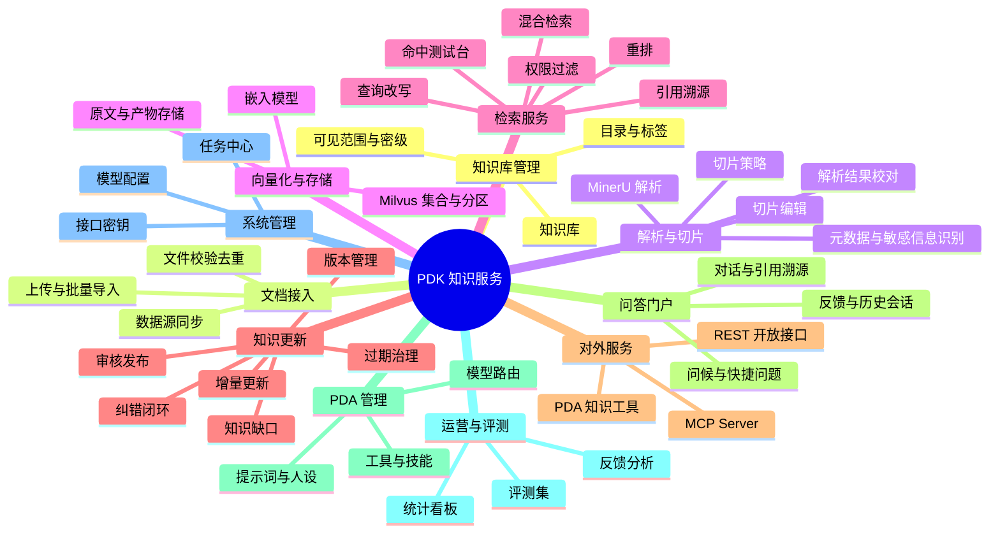

# PDK 知识服务 — 产品功能文档

> 产品名称：PDK 知识服务（PD Knowledge Service）
> 技术栈：Python 3.11+、FastAPI、LangGraph、MinerU、Milvus、PostgreSQL、Redis、MinIO
> 文档版本：V0.1 草案
> 关联文档：[总体架构与 PDA 接入方案](./00-总体架构与PDA接入方案.md)、PDS 产品功能文档（`keanying/pd_centralized_permission/docs/01-PDS产品功能文档.md`）

---

## 1. 产品定位

PDK 是集团统一的**知识中台**，负责知识的"进、存、查、改"：

- **进**：各类文档统一由 MinerU 解析，按策略切片，识别元数据与敏感信息；
- **存**：切片向量化后存入 Milvus，原文与解析产物存入对象存储，元数据存入 PostgreSQL；
- **查**：提供带权限过滤的混合检索、重排、引用溯源，供 PDA 智能助手和业务系统调用；
- **改**：版本管理、增量更新、审核发布、纠错闭环、过期治理。

PDK 提供两个管理后台：

- **知识管理后台**（本文档）：面向各景区/部门知识管理员，管好具体知识库；
- **知识接入与治理台**（见 [03-PDK知识接入与治理台](./03-PDK知识接入与治理台.md)）：面向开发和知识运营，负责飞书/文件/链接/数据库等多源接入、AI 标注分类到数据域与业务域、复核质检、路由入库与全局治理。

PDK **不负责**：用户登录、组织与权限管理（由 PDS 负责），面向最终用户的对话交互（由 PDA 负责）。PDK 的所有功能入口与数据访问都受 PDS 权限控制。

## 2. 用户角色

| 角色 | 典型人员 | 在 PDK 中做什么 |
|---|---|---|
| 知识管理员（集团） | 信息中心/知识管理岗 | 管理全集团知识库、模型配置、评测、统计 |
| 知识管理员（景区） | 各景区综合办/运营岗 | 管理本景区知识库、上传文档、审核发布 |
| 知识贡献者 | 各部门业务骨干 | 上传/编辑本部门文档，提交纠错 |
| 知识审核员 | 部门负责人/质检岗 | 审核新文档与知识更新 |
| 普通使用者 | 一线员工 | 不直接使用后台，通过 PDA 问答使用知识 |
| 开发 / 知识运营 | 集团知识工程团队 | 使用"知识接入与治理台"接入数据源、维护分类体系、AI 标注与复核、配置路由 |
| 业务系统 | 票务、客服、OA 等 | 通过开放接口调用检索 |
| PDA 智能助手 | 系统账号 | 通过知识工具（用户票据）调用检索 |

> 每个角色能做什么由 PDS 配置，以上仅为典型分工。

## 3. 功能总览



功能优先级：**P0** = 一期必须；**P1** = 二期；**P2** = 规划。

## 4. 功能详述

### 4.1 知识库管理

| 编号 | 功能 | 描述 | 优先级 |
|---|---|---|---|
| KB-01 | 新建知识库 | 填写名称、描述、**所属景区**（必填，集团级库选"集团"）、所属部门、分类、默认密级、切片策略、嵌入模型、图标 | P0 |
| KB-02 | 知识库列表 | 按景区、分类、状态、创建人筛选；只展示当前用户在 PDS 中有 `read` 权限的库 | P0 |
| KB-03 | 知识库配置 | 修改切片策略、检索参数（TopK、相似度阈值、是否重排）、默认标签；修改切片策略后提示"需重新切片"并可一键重建 | P0 |
| KB-04 | 目录管理 | 知识库内多级目录，支持拖拽排序；目录可继承或覆盖知识库的可见范围 | P1 |
| KB-05 | 标签管理 | 景区级标签体系（如"票务/安全/导览/应急"），文档和切片可打标签，检索时可按标签过滤 | P0 |
| KB-06 | 可见范围（授权） | 在知识库详情页"授权"页签设置：授权对象（组织节点/岗位/角色/用户组/**具体人员**）× 动作（查看检索/编辑/管理）× 有效期；支持"禁止某人"。数据实际保存在 PDS（资源实例 `pdk:kb:{id}`），PDK 只做展示与发起 | P0 |
| KB-07 | 密级 | 公开/内部/秘密/机密四级；文档可高于知识库默认密级；用户可访问的最高密级由 PDS 配置 | P0 |
| KB-08 | 知识库归档/删除 | 归档后不可检索但保留数据；删除为软删除，保留 30 天可恢复，过期后物理删除（含 Milvus 向量） | P0 |
| KB-09 | 跨景区共享 | 集团知识库可共享给多个景区；景区知识库默认仅本景区可见，跨景区共享需在 PDS 授权 | P0 |

### 4.2 文档接入

| 编号 | 功能 | 描述 | 优先级 |
|---|---|---|---|
| DOC-01 | 单个/批量上传 | 拖拽上传，单文件默认上限 200MB，批量上限 500 个；支持 zip 包导入（保留目录结构） | P0 |
| DOC-02 | 支持格式 | 以 MinerU 能力为准：PDF（含扫描件）、图片（PNG/JPG）、DOC/DOCX、PPT/PPTX、XLS/XLSX、RTF、ODT/ODS/ODP、EPUB、OFD、HTML/MHTML、CSV/TSV；TXT/MD 直接读取 | P0 |
| DOC-03 | 文件校验 | 格式与大小校验、文件内容哈希去重（同库重复提示"已存在，是否作为新版本"）、病毒扫描（对接现有杀毒引擎） | P0 |
| DOC-04 | 上传时元数据 | 标题、所属目录、标签、密级、生效日期、失效日期、来源、负责人；可批量设置 | P0 |
| DOC-05 | 网页导入 | 输入 URL 抓取网页（官网公告、政策页面），可设置定时重新抓取 | P1 |
| DOC-06 | 数据源同步 | 对接文件共享盘（SMB/NFS）、对象存储（S3/MinIO/OSS）、OA/内容管理系统 API；配置同步周期、目录映射、删除策略（源删除时同步下线） | P1 |
| DOC-07 | 结构化数据导入 | Excel/CSV 表格支持"整表入库"或"按行生成问答/记录"（如票价表、设施表） | P1 |
| DOC-08 | 问答对导入 | 导入 FAQ（问题-答案）表格，直接作为高优先级切片 | P0 |
| DOC-09 | 文档列表 | 显示处理状态：待解析/解析中/待校对/切片中/向量化中/待审核/已发布/失败；支持按状态、标签、上传人、时间筛选 | P0 |

### 4.3 解析（MinerU）

| 编号 | 功能 | 描述 | 优先级 |
|---|---|---|---|
| PAR-01 | 自动解析 | 文档进入解析队列，调用 MinerU 服务；输出 Markdown 与结构化 Content List（含块类型：标题/正文/表格/图片/公式/页眉页脚，及页码、坐标） | P0 |
| PAR-02 | 解析参数 | 按知识库配置：解析后端（流水线模式/视觉大模型模式）、OCR 语言（默认中文）、是否识别公式、是否识别表格、是否保留图片 | P0 |
| PAR-03 | 解析结果预览 | 左侧原文（PDF 渲染），右侧解析结果；点击解析块高亮原文位置 | P0 |
| PAR-04 | 人工校对 | 对解析错误的块进行修改（文字、表格单元格）、合并、拆分、删除（如去除无用页眉页脚）；修改后标记"人工校对" | P1 |
| PAR-05 | 清洗规则 | 景区级可配置清洗规则：去页眉页脚、去水印文字、去空白页、正则替换 | P0 |
| PAR-06 | 图片处理 | 图片保存到对象存储；可选调用多模态模型生成图片描述，作为可检索文本 | P1 |
| PAR-07 | 失败处理 | 失败原因中文提示（文件加密、损坏、超页数、超时）；支持重试、更换解析模式重试 | P0 |
| PAR-08 | 解析资源调度 | 解析任务排队、优先级（人工上传 > 定时同步）、并发上限、单文档超时；MinerU 多实例通过其 Router 负载均衡 | P0 |
| PAR-09 | 音视频转写 | 客户"企业知识"包含音视频（培训录像、会议录音、讲解音频）：调用语音识别服务（如 FunASR / Whisper 私有化部署）转写为带时间戳的文本，视频可抽取关键帧做图文描述；引用溯源定位到时间点 | P1 |
| PAR-10 | 对接 PDP 数据清洗 | 解析器按接口抽象：一期使用 PDK 内置 MinerU 通道；客户 PDP 建成后，可在知识库配置中切换为"调用 PDP 解析"，PDK 只接收解析结果 | P2 |

### 4.4 切片

| 编号 | 功能 | 描述 | 优先级 |
|---|---|---|---|
| CHK-01 | 按结构切片（默认） | 依据 MinerU 输出的标题层级切分，每个切片带"标题路径"（如：游客须知 > 票务 > 优惠政策）；超长段落再按长度二次切分 | P0 |
| CHK-02 | 定长切片 | 按字符数（默认 500 字）+ 重叠（默认 50 字）切分，在中文句号/分号处断句 | P0 |
| CHK-03 | 表格切片 | 小表格整表一个切片（保留 Markdown/HTML 表格）；大表格按行分组切片，每片重复表头 | P0 |
| CHK-04 | 父子块 | 小块用于检索、命中后返回其所在大块（章节）作为上下文，兼顾精确与完整 | P1 |
| CHK-05 | 问答对切片 | FAQ 每组问答一个切片，检索时优先 | P0 |
| CHK-06 | 摘要/假设问题增强 | 可选：由大模型为每个切片生成摘要和"可能被问的问题"，一并向量化以提升召回 | P1 |
| CHK-07 | 切片预览与编辑 | 查看切片列表，编辑内容、合并、拆分、禁用/启用、调整标签；编辑后只重算该切片向量 | P0 |
| CHK-08 | 切片元数据 | 每个切片记录：景区、知识库、文档、版本、目录、标签、密级、页码、原文坐标、标题路径、生效/失效日期、敏感信息标记 | P0 |
| CHK-09 | 敏感信息识别 | 识别手机号、身份证号、银行卡号、车牌号、人名等，标记切片敏感类型；不改变原文，检索返回时按 PDS 脱敏策略处理 | P0 |

### 4.5 向量化与存储

| 编号 | 功能 | 描述 | 优先级 |
|---|---|---|---|
| VEC-01 | 嵌入模型 | 默认中文/多语言模型（如 bge-m3，同时产出稠密与稀疏向量）；模型在"模型配置"中统一管理，支持私有化推理服务 | P0 |
| VEC-02 | Milvus 集合设计 | 每个嵌入模型一个集合；以 `scenic_id` 作为分区键实现景区物理隔离；字段见 §6.2 | P0 |
| VEC-03 | 全文/稀疏检索 | 使用稀疏向量或 Milvus 内置 BM25 全文检索，支持中文分词，解决专有名词、编号类查询 | P0 |
| VEC-04 | 批量写入与重试 | 向量化分批进行，失败可重试；写入成功后才更新文档状态 | P0 |
| VEC-05 | 模型切换与重建 | 更换嵌入模型时，新建集合后台重建，完成后一键切换，旧集合保留可回退 | P1 |
| VEC-06 | 原文与产物存储 | 原文件、解析 Markdown、Content List、图片存 MinIO，按"景区/知识库/文档/版本"分目录；访问使用临时签名链接 | P0 |

### 4.6 检索服务

| 编号 | 功能 | 描述 | 优先级 |
|---|---|---|---|
| RET-01 | 混合检索 | 稠密向量 + 稀疏/全文检索并行召回，RRF 或加权融合 | P0 |
| RET-02 | 重排 | 召回 TopN（默认 50）后使用重排模型（如 bge-reranker）取 TopK（默认 8）；低于阈值的结果丢弃 | P0 |
| RET-03 | 权限过滤 | **检索前**根据用户在 PDS 中的权限生成过滤表达式（景区范围、可读知识库、最高密级、生效期），在 Milvus 中过滤，不做"先检索后过滤"，避免越权与召回不足 | P0 |
| RET-04 | 元数据过滤 | 按知识库、目录、标签、文档类型、时间范围过滤 | P0 |
| RET-05 | 查询改写 | 口语化问题改写、多查询扩展、同义词/景区别名词典（如"大门"→"游客中心南门"） | P1 |
| RET-06 | 引用溯源 | 返回每个切片的文档名、版本、页码、原文坐标；前端可跳转原文并高亮 | P0 |
| RET-07 | 结果脱敏 | 按 PDS 下发的脱敏策略处理切片中的敏感信息（如手机号显示为 138****1234）；无权查看的字段隐藏 | P0 |
| RET-08 | 时效处理 | 已失效文档不参与检索；同一文档多版本只检索当前发布版本；可选"按日期优先" | P0 |
| RET-09 | 命中测试台 | 管理员输入问题，查看召回、融合、重排各阶段结果与得分；可切换参数对比；可"以某人身份测试"（需 `pdk:search:debug` 且受审计） | P0 |
| RET-10 | 生成式回答接口 | 可选的一站式 RAG 问答接口（检索 + 大模型生成 + 引用），供不经过 PDA 的业务系统使用 | P1 |
| RET-11 | Agentic 检索 | 复杂问题自动拆解为多个子查询，多轮检索后汇总（LangGraph 编排） | P2 |

### 4.7 知识更新

| 编号 | 功能 | 描述 | 优先级 |
|---|---|---|---|
| UPD-01 | 版本管理 | 同一文档重新上传形成新版本；保留历史版本，可对比差异、回滚；检索只使用当前发布版本 | P0 |
| UPD-02 | 增量更新 | 新版本按切片内容哈希比对，仅对新增/变更切片重新向量化，删除失效切片，降低成本与耗时 | P0 |
| UPD-03 | 审核发布 | 可按知识库开启审核：新文档/新版本/切片修改进入"待审核"，审核员查看差异后通过或驳回；不开启则自动发布 | P0 |
| UPD-04 | 定时同步 | 数据源与网页按周期检查变更，自动生成新版本（是否需审核按库配置） | P1 |
| UPD-05 | 纠错闭环 | PDA 用户对回答"点踩/纠错"→ 生成纠错工单，关联问题、回答、引用切片 → 指派给知识库负责人 → 修改切片或补充文档 → 关闭工单并通知提交人 | P1 |
| UPD-06 | 知识更新建议 | PDA 中有 `pdk:update:submit` 权限的用户可直接说"这条政策已经变了，新的是……"，由知识工具提交为更新建议，进入审核 | P1 |
| UPD-07 | 过期治理 | 文档到失效日期自动下线；到期前 N 天提醒负责人复核；长期未被命中的文档进入"待清理"清单 | P1 |
| UPD-08 | 知识缺口 | 统计"无命中/低分命中/用户追问"的问题，按景区聚类，生成待补充知识清单 | P1 |
| UPD-09 | 知识冲突检测 | 同一主题不同文档说法不一致时提示（如两份文件票价不同），由 Agent 定期巡检 | P2 |
| UPD-10 | 知识专题页 | 由 Agent 将同一主题的多文档汇编为一篇专题页（每个结论标注来源），来源变化时只更新相关段落 | P2 |
| UPD-11 | 删除与下线 | 文档下线：立即从检索中移除（Milvus 删除或状态过滤）；删除：同时删除向量、切片、产物（软删 30 天） | P0 |
| UPD-12 | 回流平台对接 | 问答评价（赞/踩/纠错）、审核修正结果、工单结果、知识使用热度（文档/切片被引用次数）通过 PBS 消息总线推送到客户回流平台，用于反哺定价、营销、调度、指标与知识 | P1 |
| UPD-13 | 对接 PDL / PDR | 切片的 AI 打标（分类、实体抽取）与人工审核按接口抽象；客户 PDL 智能标注、PDR 审核质检建成后，可将"打标"和"审核抽检"委托给它们，修正结果回流 PDK | P2 |

### 4.8 对外服务

#### 4.8.1 PDA 知识工具（hermes 插件，P0）

作为 hermes-agent 插件（toolset：`pdk`）部署在 PDA 中，模型可调用以下工具。每个工具在执行时自动带上**当前登录用户**的 PDS 票据，PDK 以该用户身份做权限过滤。

| 工具名 | 用途 | 主要参数 | 需要权限 |
|---|---|---|---|
| `pdk_list_knowledge_bases` | 列出当前用户可用的知识库 | 景区、分类 | `pda:tool:pdk_list_knowledge_bases` + `pdk:kb:view` |
| `pdk_search` | 知识检索（混合检索 + 重排） | 问题、知识库范围、标签、TopK | `pda:tool:pdk_search` + `pdk:search:use` + 库 `read` |
| `pdk_get_context` | 获取命中切片的上下文（前后段落/所在章节） | 切片 ID、窗口大小 | 同上 |
| `pdk_get_document_info` | 查看文档信息（版本、生效期、负责人） | 文档 ID | 同上 |
| `pdk_submit_feedback` | 提交回答纠错/知识更新建议 | 问题、正确内容、证据 | `pda:tool:pdk_submit_feedback` + `pdk:update:submit` |

工具返回统一包含：切片文本（已脱敏）、出处（文档/版本/页码/链接）、相关度得分；PDA 回答时必须给出引用。

#### 4.8.2 MCP Server（P1）

以 Streamable HTTP 方式提供与上表相同的工具，供其他智能体/IDE 接入；调用方需使用 PDK 接口密钥（服务身份）+ 用户票据（`X-PDS-User-Ticket`）。

#### 4.8.3 REST 开放接口（P0）

见 §7 接口清单。所有接口需携带 PDS 签发的访问令牌（用户态）或"接口密钥 + 代理用户票据"（系统态）。

### 4.9 PDA 管理（PDK 管理后台中的"智能助手"菜单）

PDA 本身是 hermes-agent，没有企业级运营后台，相关配置统一在 PDK 后台管理，下发到 PDA（配置文件 + 重载）。

| 编号 | 功能 | 描述 | 优先级 |
|---|---|---|---|
| PDA-01 | 助手人设与提示词 | 中文人设（SOUL）、回答规范（必须基于知识、必须给出引用、不知道就说不知道、禁止编造票价/时间等关键信息）；按景区可覆盖 | P0 |
| PDA-02 | 工具开关 | 列出 hermes 可用工具集，企业模式默认仅开启 `pdk`、澄清提问等安全工具；终端/文件/浏览器/代码执行默认关闭；开启的工具需在 PDS 授权给具体人 | P0 |
| PDA-03 | 技能管理 | 上传/编辑技能（如"投诉处理话术""应急预案查询"），审核后发布；禁止对话中自动创建技能（或仅管理员会话可创建，需审核后生效） | P1 |
| PDA-04 | 模型路由 | 配置可用大模型与默认模型；不同模型对应 PDS 权限点 `pda:model:{编码}` | P1 |
| PDA-05 | 欢迎语与推荐问题 | 按景区配置问答门户欢迎语、热门问题 | P0 |
| PDA-06 | 敏感词与拒答 | 敏感话题拒答、输出敏感词拦截（与 PDS 脱敏协同） | P0 |
| PDA-07 | 定时任务模板 | 如"每日开园前推送天气与预警摘要"，由有 `pda:cron:use` 权限的人订阅 | P2 |

### 4.10 问答门户（PDA 前端，"PDK 发起问答"）

面向全体员工的问答入口，界面后续用 UX Pilot 设计（参考客户提供的"对话助手首页"模板）。功能点如下：

| 编号 | 功能 | 描述 | 优先级 |
|---|---|---|---|
| POR-01 | 统一登录 | 未登录跳转 PDS 统一登录；无 `pda:chat:use` 权限时提示"暂无使用权限"并给出"申请权限"入口 | P0 |
| POR-02 | 个性化问候 | 首页按时段与姓名问候（"早上好，张三，今天想了解什么？"），背景可按当前景区配置实景图 | P0 |
| POR-03 | 输入框 | 多行输入；附件上传（需 `pda:chat:upload`，附件仅本次会话临时解析，不入库）；回答模式切换（快速回答 / 深度回答，对应不同模型或检索深度，受 `pda:model:*` 控制）；语音输入（P1） | P0 |
| POR-04 | 快捷问题 | 输入框下方的快捷标签，按景区与岗位配置（如"今日开放时间""退票规则""应急预案"） | P0 |
| POR-05 | 最近文件卡片 | 展示本人最近查看/引用过的知识文档，点击可查看原文（需权限） | P1 |
| POR-06 | 业务应用入口卡片 | 展示本人有权访问的业务应用（票付通、景数通、数字大脑、畅游等，数据来自 PDS 应用准入），点击单点登录跳转；后续可在对话中直接调用这些应用的能力 | P1 |
| POR-07 | 最近对话卡片 | 展示本人最近的会话，点击继续对话 | P0 |
| POR-08 | 对话页 | 流式输出；Markdown/表格渲染；引用角标，点击展开引用卡片（文档名、版本、页码、片段），可跳转原文高亮；显示"正在检索知识库…"等工具进度 | P0 |
| POR-09 | 回答反馈 | 赞 / 踩（选择原因）/ 纠错（填写正确内容）；复制、重新生成 | P0 |
| POR-10 | 知识范围选择 | 可选"在指定知识库内提问"（只列出有权限的库） | P1 |
| POR-11 | 历史会话 | 搜索、重命名、删除本人会话；导出需 `pda:chat:export` | P0 |
| POR-12 | 景区切换 | 多景区人员可切换当前景区，切换后检索范围随之变化 | P0 |
| POR-13 | 移动端 / 企业 IM | H5 自适应；后续接入企业微信/钉钉工作台 | P2 |

### 4.11 运营与评测

| 编号 | 功能 | 描述 | 优先级 |
|---|---|---|---|
| OPS-01 | 统计看板 | 知识库/文档/切片数量、解析成功率、检索调用量、平均耗时、无命中率、点赞点踩率；按景区、知识库、时间维度 | P0 |
| OPS-02 | 热门问题 | 高频问题 TopN，可一键沉淀为 FAQ | P1 |
| OPS-03 | 评测集 | 维护"问题-标准答案-标准出处"评测集；每次调整参数/模型后跑评测 | P1 |
| OPS-04 | 评测指标 | 召回率、命中率、MRR、答案正确性、引用准确性、忠实度（借鉴 all-in-rag 系统评估章节） | P1 |
| OPS-05 | 反馈分析 | 点踩原因分类（答非所问/信息过时/无答案/有错误），关联到知识库负责人 | P1 |

### 4.12 系统管理

| 编号 | 功能 | 描述 | 优先级 |
|---|---|---|---|
| SYS-01 | 任务中心 | 解析、切片、向量化、同步、重建等异步任务列表，可查看进度、日志、失败原因，支持重试/取消 | P0 |
| SYS-02 | 模型配置 | 嵌入、重排、多模态、生成模型的服务地址、并发、超时；连通性测试 | P0 |
| SYS-03 | 接口密钥 | 为业务系统创建接口密钥，绑定可访问的知识库与 IP 白名单，可设置有效期与调用配额 | P0 |
| SYS-04 | 系统参数 | 上传限制、默认切片参数、默认检索参数、保留期等 | P0 |
| SYS-05 | 操作日志 | 本系统操作日志同步上报 PDS 审计中心，本地保留 30 天便于排障 | P0 |

## 5. 权限控制说明

1. **登录**：PDK 管理后台作为 PDS 的 OIDC 客户端，未登录跳转 PDS 统一登录；不维护本地账号。
2. **功能权限**：菜单、按钮、接口均对应 PDS 权限点（见总体架构文档 §6.1），前端按权限渲染，后端接口强制校验。
3. **数据权限**：
   - 景区隔离：用户只能看到其景区范围内的知识库；所有查询自动附加 `scenic_id in (...)`；
   - 知识库实例授权：以 PDS 资源实例 `pdk:kb:{id}` 的 `read/write/admin` 为准，支持授权到具体人员，支持禁止；
   - 密级：用户最高可访问密级由 PDS 下发，高于该密级的文档不可见、不可检索；
   - 数据范围：如"只能管理本部门上传的文档"按 PDS 数据范围（SELF/DEPT/DEPT_TREE/SCENIC…）控制。
4. **字段脱敏**：文档元数据中的负责人联系方式、切片中识别出的敏感信息，按 PDS 脱敏策略返回。
5. **审计**：登录、查看、下载、上传、编辑、删除、授权、检索（含问题、命中文档）均上报 PDS 审计中心。
6. **缓存**：PDK 缓存用户权限快照（Redis，默认 5 分钟，按 PDS 变更事件主动失效）。

## 6. 数据模型（核心）

### 6.1 PostgreSQL 主要表

| 表 | 关键字段 |
|---|---|
| `kb_knowledge_base` | id, scenic_id, dept_id, name, category, default_security_level, chunk_strategy(json), embed_model, retrieval_config(json), review_required, status, owner_id, created_at |
| `kb_folder` | id, kb_id, parent_id, name, sort |
| `kb_tag` | id, scenic_id, name, group |
| `doc_document` | id, kb_id, scenic_id, folder_id, title, file_type, source_type, source_uri, security_level, effective_from, effective_to, owner_id, current_version_id, status |
| `doc_version` | id, document_id, version_no, file_hash, oss_path, parse_result_path, status(待解析…已发布), reviewer_id, published_at |
| `doc_chunk` | id, version_id, document_id, kb_id, scenic_id, seq, content, content_hash, title_path, page_no, bbox(json), chunk_type(正文/表格/FAQ/图片描述), parent_chunk_id, tags, security_level, pii_types, enabled |
| `upd_ticket` | id, type(纠错/更新建议/缺口), question, answer, chunk_ids, suggestion, submitter_id, assignee_id, status |
| `sys_task` | id, type, ref_id, status, progress, error, retries, started_at, finished_at |
| `sys_api_key` | id, name, key_hash, kb_scope, ip_whitelist, quota, expires_at |
| `pda_config` | id, scenic_id, type(人设/工具/技能/欢迎语), content, version, status |

### 6.2 Milvus 集合（每个嵌入模型一个）

| 字段 | 类型 | 说明 |
|---|---|---|
| `chunk_id` | VARCHAR（主键） | 与 `doc_chunk.id` 一致 |
| `dense_vector` | FLOAT_VECTOR | 稠密向量（HNSW 索引，COSINE） |
| `sparse_vector` | SPARSE_FLOAT_VECTOR | 稀疏向量 / BM25 |
| `text` | VARCHAR | 切片文本（全文检索用） |
| `scenic_id` | VARCHAR（**分区键**） | 景区隔离 |
| `kb_id` | VARCHAR | 知识库 |
| `doc_id` / `version_id` | VARCHAR | 文档与版本 |
| `security_level` | INT8 | 密级 |
| `tags` | ARRAY<VARCHAR> | 标签 |
| `effective_from` / `effective_to` | INT64 | 生效期（时间戳） |
| `status` | INT8 | 1=已发布 |

权限过滤表达式示例（由 PDS 权限快照生成）：

```text
scenic_id in ["S001","GROUP"] and kb_id in ["kb_12","kb_35"] and security_level <= 2
and status == 1 and effective_from <= 1762502400 and effective_to >= 1762502400
```

## 7. 接口清单（REST，前缀 `/api/v1`）

| 分类 | 方法与路径 | 说明 |
|---|---|---|
| 知识库 | `GET/POST /kbs`，`GET/PUT/DELETE /kbs/{id}` | 知识库增删改查 |
| 授权 | `GET/PUT /kbs/{id}/grants` | 代理读写 PDS 资源授权 |
| 文档 | `POST /kbs/{id}/documents`（multipart），`GET /documents`，`GET/PUT/DELETE /documents/{id}` | 文档管理 |
| 版本 | `GET /documents/{id}/versions`，`POST /documents/{id}/versions/{vid}:rollback` | 版本与回滚 |
| 解析 | `GET /versions/{vid}/parse-result`，`PUT /versions/{vid}/parse-result/blocks/{bid}` | 解析结果查看与校对 |
| 切片 | `GET /versions/{vid}/chunks`，`PUT/DELETE /chunks/{id}` | 切片管理 |
| 审核 | `GET /reviews`，`POST /reviews/{id}:approve`，`POST /reviews/{id}:reject` | 审核发布 |
| 检索 | `POST /search` | 混合检索（问题、范围、过滤、TopK、是否重排）|
| 上下文 | `GET /chunks/{id}/context` | 切片上下文 |
| 问答 | `POST /answer` | 可选 RAG 问答（流式）|
| 反馈 | `POST /feedback`，`GET/PUT /tickets/{id}` | 纠错与工单 |
| 数据源 | `GET/POST/PUT/DELETE /datasources`，`POST /datasources/{id}:sync` | 数据源 |
| 任务 | `GET /tasks`，`POST /tasks/{id}:retry`，`POST /tasks/{id}:cancel` | 任务中心 |
| 统计 | `GET /stats/overview`，`GET /stats/questions` | 运营统计 |
| 评测 | `GET/POST /eval/sets`，`POST /eval/runs` | 评测 |
| MCP | `/mcp` | MCP Streamable HTTP 端点 |
| 健康 | `GET /healthz`，`GET /readyz` | 探针 |

统一响应：`{"code": 0, "message": "成功", "data": {...}, "trace_id": "..."}`；错误信息均为中文。

## 8. 管理后台菜单

```
PDK 知识服务
├── 工作台（待审核、待处理工单、失败任务、近 7 日统计）
├── 知识库
│   ├── 知识库列表
│   └── 知识库详情（文档 / 切片 / 授权 / 配置 / 命中测试）
├── 审核中心（待我审核 / 我提交的）
├── 知识运营
│   ├── 纠错工单
│   ├── 知识缺口
│   ├── 过期复核
│   └── 热门问题
├── 智能助手（PDA）
│   ├── 人设与提示词
│   ├── 工具与技能
│   ├── 模型路由
│   └── 欢迎语与推荐问题
├── 数据源
├── 评测中心
├── 统计分析
└── 系统设置（模型配置 / 接口密钥 / 任务中心 / 系统参数）
```

## 9. 非功能需求

| 类别 | 指标 |
|---|---|
| 性能 | 检索接口 P95 ≤ 800ms（不含生成）；带重排 P95 ≤ 1.5s；单节点检索并发 ≥ 50 QPS |
| 解析吞吐 | 单 GPU（24G）文字型 PDF ≥ 1 页/秒；任务排队可视化 |
| 规模 | 一期支持 10 万文档 / 1000 万切片；Milvus 可水平扩展 |
| 可用性 | API 无状态多实例，可用性 ≥ 99.9%；任务失败自动重试 3 次 |
| 安全 | 全部接口鉴权；原文访问使用临时签名链接（有效期 5 分钟）；数据传输 TLS；敏感配置加密存储 |
| 隔离 | 景区间数据在 Milvus 分区、对象存储目录、数据库查询三层隔离 |
| 可观测 | 链路追踪（trace_id 贯穿 PDA→PDK→Milvus）、指标（Prometheus）、结构化日志 |
| 合规 | 满足等保 2.0 三级相关要求；审计日志由 PDS 统一留存 ≥ 6 个月 |
| 本地化 | 界面、提示、错误、日志展示全中文；时间统一东八区 |

## 10. 建议的代码结构

```
pd_knowledge_service/
├── docs/                      # 产品与设计文档
├── pdk/
│   ├── api/                   # FastAPI 路由
│   ├── auth/                  # PDS OIDC 客户端、票据校验、权限快照缓存
│   ├── ingest/                # 接入流水线（LangGraph）：校验→解析→清洗→切片→向量化
│   ├── parsers/               # MinerU 客户端与结果转换
│   ├── chunking/              # 切片策略
│   ├── retrieval/             # 混合检索、重排、查询改写、权限过滤表达式
│   ├── update/                # 版本、增量、审核、工单
│   ├── mcp/                   # MCP Server
│   ├── storage/               # PostgreSQL / Milvus / MinIO 访问层
│   └── workers/               # 异步任务
├── pda/
│   ├── gateway/               # PDA 接入网关（SSO、会话映射、转发 hermes）
│   ├── hermes_plugins/
│   │   ├── pdk_tools/         # pdk_* 知识工具
│   │   └── pds_guard/         # 权限守卫、审计、脱敏钩子
│   ├── skills/                # 中文业务技能
│   └── portal/                # 中文问答门户（Web/H5）
├── web/                       # PDK 管理后台前端（Vue3）
└── deploy/                    # Docker Compose / Helm
```

## 11. 验收要点（一期）

1. 上传一份扫描版 PDF 和一份含表格的 Word，能正确解析、切片，原文高亮可定位到页与段落；
2. 景区 A 的员工在 PDA 中提问，回答只引用景区 A 与集团共享的知识，引用可点击查看原文；
3. 在 PDS 中对某员工"禁止"访问某知识库，60 秒内该员工 PDA 回答不再引用该库内容；
4. 切片中的手机号对普通员工显示为掩码，对授权人员显示明文；
5. 文档上传新版本后，只有变更切片被重新向量化，旧版本内容不再被检索到；
6. 所有检索与问答在 PDS 审计中心可按人员、时间、知识库查询。
