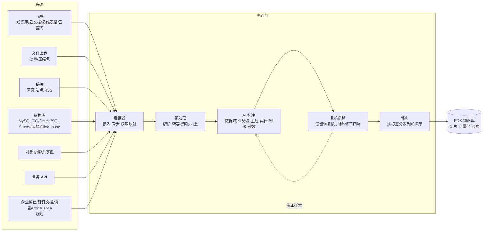
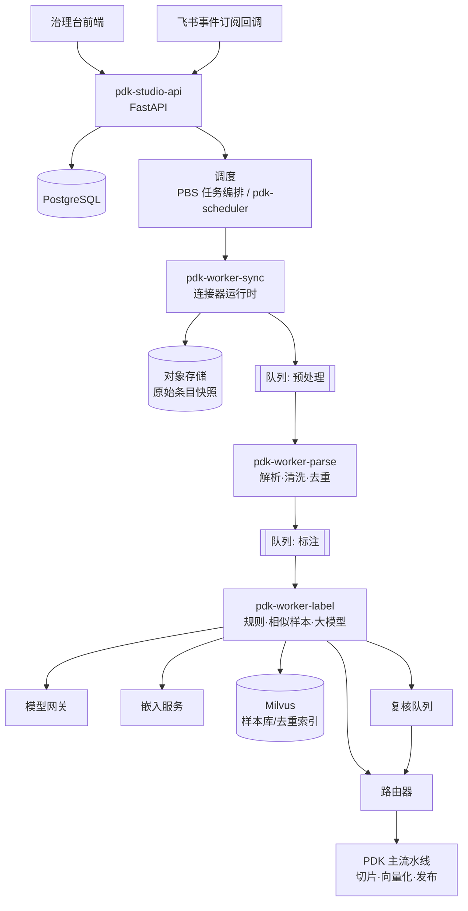
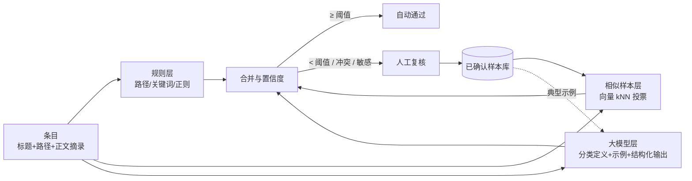

# PDK 知识接入与治理台 — 功能与技术方案

> 文档版本：V0.1 草案
> 使用对象：开发人员、数据/知识运营人员（企业内部的知识工程团队）
> 关联文档：[00-总体架构](./00-总体架构与PDA接入方案.md)、[01-PDK 产品功能文档](./01-PDK产品功能文档.md)、[02-PDK 技术方案](./02-PDK技术方案.md)

---

## 1. 定位与边界

PDK 有两个管理后台，面向不同人群：

| | PDK 知识管理后台（01 文档） | **PDK 知识接入与治理台（本文档）** |
|---|---|---|
| 使用者 | 各景区/部门的知识管理员、贡献者、审核员 | 开发人员、知识运营、数据运营（集团知识工程团队） |
| 关注点 | 管好"某个知识库"：上传、校对、审核、授权、命中测试 | 管好"知识从哪里来、是什么、该去哪"：多源接入、AI 标注分类、复核质检、路由入库、全局治理 |
| 粒度 | 单库、单文档 | 全集团、海量内容（百万级文件/记录） |
| 典型操作 | 上传一份文件并发布 | 接入一个飞书知识空间（数万文档），自动标注到数据域/业务域，自动分发到 30 个知识库，并持续增量同步 |

在客户总体架构中，治理台承担"企业知识"这条线上的 **PDC 数据集成**（离线同步、实时采集、文件采集、API 接入）、**PDP 数据清洗**（去重、解析、识别、转写）、**PDL 智能标注**（AI 粗标、抽取、分类）、**PDR 审核质检**（人工审核、抽检、修正回流）能力。客户的 PDC/PDP/PDL/PDR 平台建成后，治理台的对应环节可切换为调用它们，治理台保留编排、配置与监控。



## 2. 核心概念

| 概念 | 说明 |
|---|---|
| 数据源（连接器实例） | 一个具体的接入配置，如"飞书-集团制度知识空间""票务库-MySQL-产品表"。由连接器类型 + 凭证 + 范围 + 同步策略组成 |
| 原始条目 | 从数据源取得的最小内容单元：一个文件、一篇飞书文档、一个网页、一条/一组数据库记录 |
| 分类体系 | 两个正交维度：**数据域**（内容描述的是哪类业务数据，如票务、订单、经营）与**业务域**（内容服务于哪类业务场景，如游客服务、安全应急、市场营销）。二者都是多级树 |
| 标签模板 | 一次标注要产出的字段集合：数据域、业务域、文档类型、主题标签、实体、景区、密级建议、时效、摘要、问答对等 |
| 标注任务 | 对一批原始条目执行标签模板的任务，有进度、成本、质量指标 |
| 置信度 | 每个标签的可信程度（0–1），决定自动通过还是进入人工复核 |
| 路由规则 | 根据标签决定条目进入哪个/哪些知识库，以及默认密级和可见范围 |
| 治理流水线 | 从数据源到知识库的完整处理步骤（可视化编排，版本化） |

### 2.1 分类体系示例（需与客户确认）

**数据域**（参考客户架构"业务数据"）：

| 一级 | 二级示例 |
|---|---|
| 票务 | 票种与价格、优惠政策、退改规则、检票核销、团队票 |
| 订单 | 订单流程、支付、发票、售后 |
| 经营 | 客流、营收、经营指标口径 |
| 营销 | 活动、渠道、会员、优惠券 |
| OTA | 渠道对接、上架规则、结算 |
| 财务 | 报销、结算、对账 |
| ERP | 采购、库存、资产 |
| 终端 | 闸机、自助机、手持设备 |

**业务域**：

| 一级 | 二级示例 |
|---|---|
| 游客服务 | 咨询话术、投诉处理、失物招领、无障碍服务 |
| 安全应急 | 应急预案、安全规范、天气预警 |
| 运营管理 | 开放时间、客流管控、排班 |
| 市场营销 | 品牌宣传、活动执行 |
| 设施设备 | 设备手册、维修保养 |
| 人力行政 | 制度、培训、考勤 |
| 文旅政策 | 行业法规、政府文件 |
| 技术研发 | 系统文档、接口文档、运维手册 |

每个分类节点包含：名称、编码、定义（一句话说明什么内容属于它）、包含/排除示例、关键词、负责人、默认路由的知识库、默认密级。**定义和示例直接作为 AI 标注的依据**，写得越清楚，标注越准。

## 3. 功能清单

优先级：**P0** = 一期必须；**P1** = 二期；**P2** = 规划。

### 3.1 接入总览（首页）

| 编号 | 功能 | 描述 | 优先级 |
|---|---|---|---|
| OV-01 | 接入概况 | 数据源数、原始条目总数、今日新增/变更/删除、待标注、待复核、已入库 | P0 |
| OV-02 | 流水线漏斗 | 接入 → 预处理 → 标注 → 复核 → 入库 各阶段数量与转化、积压 | P0 |
| OV-03 | 数据源健康 | 每个数据源最近同步时间、状态（正常/延迟/失败/凭证过期）、速率限制情况 | P0 |
| OV-04 | 标注质量 | 自动通过率、复核修改率、抽检准确率（按数据域/业务域） | P1 |
| OV-05 | 成本 | 大模型调用量与费用、解析 GPU 时长（按数据源/任务） | P1 |
| OV-06 | 告警 | 同步失败、凭证即将过期、积压超阈值、准确率下降 | P0 |

### 3.2 连接器与数据源

#### 3.2.1 连接器类型

| 连接器 | 接入范围 | 同步方式 | 优先级 |
|---|---|---|---|
| **飞书** | 知识库（Wiki 空间/节点树）、云文档（文档、电子表格）、多维表格、云空间文件夹（PDF/Word 等附件） | 全量 + 增量（按修改时间/版本）+ 事件订阅（文档变更实时触发） | P0 |
| **文件上传** | 单文件、批量、zip 包（保留目录） | 手动 | P0 |
| **链接** | 单个网页、站点（按入口 URL + 深度 + 路径规则爬取）、RSS、站点地图 | 定时重抓，按内容哈希判断变化 | P0 |
| **数据库** | MySQL、PostgreSQL、Oracle、SQL Server、达梦、人大金仓、ClickHouse、Hive | 全量 + 增量（时间戳/自增列）；CDC 由 PDC 提供（P2） | P0 |
| 对象存储 | S3 / MinIO / OSS 存储桶与前缀 | 定时 + 存储事件 | P1 |
| 共享盘 | SMB / NFS 目录 | 定时扫描 | P1 |
| 业务 API | REST（分页、鉴权、字段映射） | 定时 | P1 |
| 企业微信文档 / 钉钉文档 / 语雀 / Confluence / Git 仓库 | — | — | P2 |
| 自定义连接器 | 开发人员按 SDK 开发并注册 | — | P1 |

#### 3.2.2 数据源管理功能

| 编号 | 功能 | 描述 | 优先级 |
|---|---|---|---|
| SRC-01 | 连接器市场 | 卡片展示可用连接器（图标、说明、支持能力：增量/实时/权限同步），点击"接入"进入向导 | P0 |
| SRC-02 | 接入向导 | 分步：① 选择连接器 ② 认证（飞书应用凭证/数据库账号/API 密钥，测试连接）③ 选择范围（飞书空间与文件夹树勾选、数据库库表勾选、网站路径规则）④ 同步策略（全量/增量/实时、周期、删除策略）⑤ 处理配置（关联治理流水线、标签模板、默认景区）⑥ 权限映射 ⑦ 预览与确认（抽样 20 条展示将接入的内容） | P0 |
| SRC-03 | 凭证管理 | 凭证加密存储，界面只显示掩码；支持到期提醒、轮换；凭证与数据源分离，可复用 | P0 |
| SRC-04 | 同步控制 | 立即同步、暂停、恢复、全量重建；同步历史（每次新增/更新/删除/失败数、耗时、日志） | P0 |
| SRC-05 | 条目浏览 | 按数据源浏览原始条目：标题、来源路径、类型、大小、来源更新时间、处理阶段、标签、目标知识库；可单条重处理、排除 | P0 |
| SRC-06 | 排除规则 | 按路径、文件类型、标题关键字、大小、更新时间排除（如排除"草稿""个人"文件夹） | P0 |
| SRC-07 | 删除策略 | 来源删除时：同步下线 / 保留并标记 / 仅提醒 | P0 |
| SRC-08 | 速率与时段 | 每个数据源的并发、每分钟调用上限（遵守飞书开放平台频控）、允许同步的时段（数据库只在夜间） | P0 |
| SRC-09 | 来源权限映射 | 可选"继承来源权限"：飞书文档的协作者/可见范围映射为 PDS 人员与组织（按手机号/邮箱/工号匹配），作为该条目的资源授权建议；未匹配的人员列入待处理清单。默认不继承，按路由规则定权限 | P1 |

#### 3.2.3 数据库接入专项

数据库内容有两种接入模式，在向导中选择：

| 模式 | 用途 | 处理方式 | 优先级 |
|---|---|---|---|
| **记录转知识** | 产品表、票价表、设施表、FAQ 表等"本身就是知识"的数据 | 选表与字段 → 配置行模板（如"{设施名}位于{位置}，开放时间{开放时间}，联系电话{电话}"）或按"字段名：值"自动生成 → 每行/每组记录成为一个条目；主键作为条目 ID，支持增量 | P0 |
| **元数据知识** | 让智能体"懂数据"：表结构、字段含义、指标口径、枚举值 | 读取库/表/字段/注释/样例值（抽样且脱敏）→ 生成数据字典文档 → 标注数据域 → 供后续 PDQ 智能问数、PDD 数据服务使用 | P1 |

数据库安全要求：只允许只读账号；查询语句仅限 SELECT 且由系统生成或经白名单审核；字段可标记"敏感"（不入库或脱敏后入库）；抽样数据不出内网。

### 3.3 预处理

| 编号 | 功能 | 描述 | 优先级 |
|---|---|---|---|
| PRE-01 | 解析 | 文件走 MinerU（与 PDK 主流水线共用）；飞书文档直接按块结构转换为内部文档模型（保留标题层级、表格、图片）；网页提取正文去导航 | P0 |
| PRE-02 | 转写 | 音视频转写为带时间戳文本 | P1 |
| PRE-03 | 清洗 | 去页眉页脚、去水印、去模板化内容、繁简转换、空白规范化 | P0 |
| PRE-04 | 去重 | 精确去重（内容哈希）+ 近似去重（SimHash/MinHash，相似度 ≥ 0.9 视为重复）；重复组中按"来源权威性 > 更新时间"保留主版本，其余关联为副本 | P0 |
| PRE-05 | 语言与质量检测 | 识别空文档、乱码、过短内容、纯图片无文字等，标记"低质量"不进入标注 | P0 |
| PRE-06 | 敏感信息识别 | 手机号、身份证、银行卡等识别并标记（与 PDS 脱敏协同） | P0 |

### 3.4 分类体系管理

| 编号 | 功能 | 描述 | 优先级 |
|---|---|---|---|
| TAX-01 | 数据域/业务域维护 | 树形编辑：新增、移动、合并、停用节点；每节点维护定义、包含/排除示例、关键词、负责人、默认知识库、默认密级 | P0 |
| TAX-02 | 自定义标签维度 | 除两个固定维度外，可新增维度（文档类型、适用人群、适用季节等），定义取值类型（单选/多选/文本/日期/数值） | P0 |
| TAX-03 | 版本管理 | 分类体系发布版本；变更（如拆分节点）后，可对受影响条目发起重新标注 | P1 |
| TAX-04 | 分类体系发现 | AI 对未标注内容做聚类，按簇给出"建议新增分类"（名称、定义、代表文档），人工确认后加入 | P2 |
| TAX-05 | 映射关系 | 数据域 × 业务域 矩阵视图，查看每个交叉格的内容量、对应知识库 | P1 |

### 3.5 AI 标注

| 编号 | 功能 | 描述 | 优先级 |
|---|---|---|---|
| LBL-01 | 标签模板 | 选择要标注的字段：数据域、业务域、文档类型、主题标签、实体抽取（景区、票种、价格、时间、地点、联系人、设备）、所属景区、密级建议、生效/失效日期、摘要、问答对；每个字段可设置置信度阈值 | P0 |
| LBL-02 | 标注策略 | 规则优先（关键词/来源路径/正则直接命中，如飞书"票务部/价格"文件夹 → 数据域=票务）→ 相似样本分类（与已确认样本向量相似）→ 大模型分类（带分类定义与示例）；多路结果合并给出最终标签与置信度 | P0 |
| LBL-03 | 标注任务 | 创建任务：选择范围（数据源/条目筛选/知识库）、标签模板、模型、优先级、预算上限；查看进度、吞吐、预估完成时间、费用；暂停/取消/重跑 | P0 |
| LBL-04 | 自动标注 | 新接入/变更的条目按数据源绑定的模板自动标注，无需手工建任务 | P0 |
| LBL-05 | 文档级 + 切片级 | 文档级标注决定分类与路由；切片级标注主题与实体，用于检索过滤与知识图谱 | P0（文档级）/ P1（切片级） |
| LBL-06 | 试标注 | 修改模板或分类定义后，抽样 50 条试标注，与当前结果对比差异，确认后再全量执行 | P0 |
| LBL-07 | 标注解释 | 每个标签显示依据：命中的规则 / 相似样本 / 大模型给出的理由与原文证据片段 | P0 |
| LBL-08 | 模型配置 | 选择大模型、嵌入模型；并发、超时、重试；按内容哈希缓存结果，内容不变不重复调用 | P0 |

### 3.6 复核质检（人工）

| 编号 | 功能 | 描述 | 优先级 |
|---|---|---|---|
| REV-01 | 复核队列 | 置信度低于阈值、多路结果冲突、命中敏感规则、新分类节点的条目进入复核；按数据域/业务域/负责人分派 | P0 |
| REV-02 | 复核工作台 | 左侧原文预览（高亮证据片段），右侧标签表单（AI 建议值 + 置信度），一键"接受全部"或逐项修改；快捷键（接受、下一条、跳过）；批量复核同类条目 | P0 |
| REV-03 | 抽检 | 对自动通过的条目按比例抽检（默认 5%），统计准确率；准确率低于阈值时自动提高复核比例并告警 | P1 |
| REV-04 | 修正回流 | 人工修正的结果成为"已确认样本"：① 进入相似样本库提升后续分类 ② 典型样本自动推荐为分类节点示例 ③ 统计常见错误，提示优化分类定义 | P0 |
| REV-05 | 多人一致性 | 关键分类可设置双人复核，不一致时由负责人仲裁 | P2 |
| REV-06 | 复核绩效 | 每人复核量、修改率、耗时 | P1 |

### 3.7 路由与入库

| 编号 | 功能 | 描述 | 优先级 |
|---|---|---|---|
| RTE-01 | 路由规则 | 条件（数据域、业务域、景区、来源、文档类型、标签）→ 动作（进入知识库 X、目录 Y，设置密级、标签、是否需要审核）；规则有优先级，支持"同时进入多个知识库" | P0 |
| RTE-02 | 默认路由 | 未命中规则时按分类节点的"默认知识库"；仍无则进入"待分发"池 | P0 |
| RTE-03 | 路由模拟 | 修改规则前，用最近 1000 条条目模拟，展示路由变化 | P1 |
| RTE-04 | 入库 | 路由后进入 PDK 主流水线（切片、向量化、审核发布），标签写入文档与切片元数据，检索时可按数据域/业务域过滤 | P0 |
| RTE-05 | 重新路由 | 规则或标签变化后，对受影响条目重新分发（旧库下线、新库上线） | P1 |

### 3.8 知识地图

| 编号 | 功能 | 描述 | 优先级 |
|---|---|---|---|
| MAP-01 | 覆盖热力图 | 数据域 × 业务域 矩阵，格子颜色代表内容量；点击下钻到条目列表 | P0 |
| MAP-02 | 景区覆盖 | 每个景区在各领域的知识覆盖度，对比集团标准清单找缺口 | P1 |
| MAP-03 | 时效与质量 | 各领域过期内容占比、低质量占比、重复占比 | P1 |
| MAP-04 | 需求对照 | 结合 PDA 问答的"无命中问题"聚类，标出"问得多但知识少"的领域 | P1 |

### 3.9 流水线编排（开发者）

| 编号 | 功能 | 描述 | 优先级 |
|---|---|---|---|
| PIP-01 | 可视化编排 | 节点：来源 → 解析 → 清洗 → 去重 → 标注 → 复核 → 路由 → 切片 → 向量化；可配置节点参数，可插入自定义节点（如"调用 PDP/PDL 服务"） | P1 |
| PIP-02 | 版本与灰度 | 流水线配置版本化；新版本可先对某个数据源或 10% 流量生效 | P1 |
| PIP-03 | 调试运行 | 选择一个条目单步运行，查看每个节点的输入输出 | P0 |
| PIP-04 | 自定义连接器 SDK | Python 接口规范 + 脚手架 + 本地调试工具；注册后出现在连接器市场 | P1 |
| PIP-05 | 开放接口与 Webhook | 外部系统推送内容、订阅"入库完成""标注完成"事件 | P1 |

### 3.10 运维与日志

| 编号 | 功能 | 描述 | 优先级 |
|---|---|---|---|
| OPS-01 | 任务监控 | 所有同步、预处理、标注、入库任务的状态、日志、失败原因；失败重试、批量重试 | P0 |
| OPS-02 | 队列与资源 | 各队列积压、Worker 数、GPU/模型服务负载 | P0 |
| OPS-03 | 操作审计 | 数据源与凭证变更、分类体系变更、规则变更、复核操作全部上报 PDS 审计 | P0 |

## 4. 权限设计（新增 PDS 权限点）

治理台作为 PDK 的独立入口，单独注册权限点：

| 权限编码 | 名称 | 典型角色 |
|---|---|---|
| `pdk:studio:access` | 进入知识接入与治理台 | 开发、知识运营 |
| `pdk:source:view` | 查看数据源与条目 | 开发、知识运营 |
| `pdk:source:manage` | 新建/修改/删除数据源，同步控制 | 开发 |
| `pdk:credential:manage` | 管理接入凭证 | 开发（高风险，需审批） |
| `pdk:taxonomy:manage` | 维护分类体系 | 知识运营负责人 |
| `pdk:label:task` | 创建与管理标注任务、标签模板 | 知识运营 |
| `pdk:label:review` | 复核标注 | 知识运营、业务专家 |
| `pdk:route:manage` | 维护路由规则 | 知识运营负责人 |
| `pdk:pipeline:manage` | 编排流水线、自定义连接器 | 开发 |
| `pdk:map:view` | 查看知识地图 | 管理层、知识运营 |
| `pdk:studio:cost` | 查看成本 | 负责人 |

数据范围：数据源归属景区/部门，复核任务可按数据域/业务域分派（数据范围扩展 `DOMAIN`：指定数据域/业务域节点）。原始条目在入库前同样受景区隔离与密级控制：治理台人员只能看到其景区范围内数据源的条目，跨景区数据源由集团团队管理。

## 5. 技术方案

### 5.1 架构



- 新增服务：`pdk-studio-api`（可与 `pdk-api` 同进程不同路由起步）、`pdk-worker-sync`、`pdk-worker-label`；解析 Worker 与主流水线共用。
- 编排：每个原始条目的处理是一条 LangGraph 流程（复用 02 文档的检查点机制），"人工复核"为中断节点。

### 5.2 连接器框架

```python
class Connector(Protocol):
    type: str                                   # "feishu" / "database" / "web" / ...
    capabilities: set[str]                      # {"incremental", "realtime", "acl"}

    async def test(self, cfg: SourceConfig) -> TestResult: ...
    async def list_scope(self, cfg, parent: str | None) -> list[ScopeNode]: ...   # 向导中的范围树
    async def list_changes(self, cfg, cursor: str | None) -> ChangePage: ...       # 新增/修改/删除 + 新游标
    async def fetch(self, cfg, item_ref: ItemRef) -> RawItem: ...                  # 内容 + 元数据
    async def fetch_acl(self, cfg, item_ref: ItemRef) -> SourceACL | None: ...     # 可选
    async def handle_event(self, cfg, event: dict) -> list[ItemRef]: ...           # 可选，实时变更
```

- **同步状态**：每个数据源保存游标（时间戳/版本号/分页令牌）；每个条目保存来源版本号与内容哈希，内容未变不重复处理。
- **限流**：令牌桶按数据源 + 连接器类型双层限流；遇到频控错误按服务端返回的重试时间退避。
- **凭证**：使用 PBS 密钥管理或数据库字段 AES-GCM/SM4 加密；Worker 运行时解密，日志脱敏。
- **原始快照**：每个条目版本的原始内容存对象存储，便于重处理与追溯。

**飞书连接器要点**

| 项目 | 方案 |
|---|---|
| 认证 | 企业自建应用（App ID / App Secret）获取租户访问凭证；需管理员在飞书后台授予文档、知识库、多维表格、云空间的读取权限，并将应用添加为目标知识空间/文件夹的成员 |
| 范围 | 知识空间 → 节点树；云空间 → 文件夹树；多维表格 → 数据表；向导中懒加载树 |
| 内容获取 | 云文档按块结构读取（标题、段落、列表、表格、图片、引用），直接转为内部文档模型，**不需要 OCR**；附件文件下载后走 MinerU；电子表格/多维表格按"记录转知识"处理 |
| 增量 | 按文档修改时间/版本号比较；每日全量对账一次处理删除 |
| 实时 | 订阅飞书云文档变更事件，回调到 `pdk-studio-api` 后入队；回调做签名校验与去重 |
| 权限映射 | 读取文档协作者/成员，飞书用户按手机号/邮箱/工号映射 PDS 人员（可选功能） |
| 频控 | 遵守飞书开放平台接口频率限制，按接口分组限流 |

> 具体接口、权限名称与频控数值以飞书开放平台当前文档为准，开发阶段第一周用测试租户验证。

**数据库连接器要点**

| 项目 | 方案 |
|---|---|
| 驱动 | SQLAlchemy + 各数据库方言（达梦、人大金仓使用其官方方言包） |
| 安全 | 只读账号；只执行系统生成的 SELECT；查询超时与行数上限；连接走内网/专线 |
| 增量 | 指定增量列（更新时间或自增 ID）；删除检测靠周期性主键对账；CDC 由客户 PDC 提供后接入 |
| 记录转知识 | Jinja2 行模板；分组（如按"景区+票种"把多行合并为一个条目）；字段级"敏感/排除"配置 |
| 元数据知识 | 读取信息模式（表、列、类型、注释）+ 抽样值（脱敏）→ 大模型生成字段说明草稿 → 人工确认 |

### 5.3 去重

- 精确：规范化文本 SHA-256。
- 近似：文档级 SimHash（64 位，海明距离 ≤ 3）初筛 + MinHash LSH 复核；结果写入"重复组"表。
- 主版本选择：来源权威性（数据源配置的优先级）> 更新时间 > 完整度。

### 5.4 AI 标注引擎



| 环节 | 方案 |
|---|---|
| 输入构造 | 标题 + 来源路径 + 正文前 N 字 + 各级标题目录（长文档不全文送模型，控制成本）；切片级标注按切片送 |
| 规则层 | 命中即给出高置信度（0.95）；规则可由运营在界面配置 |
| 相似样本层 | 已确认样本的嵌入向量存 Milvus（独立集合 `pdk_label_samples`）；取 Top-10 近邻按相似度加权投票，置信度 = 加权票占比 × 平均相似度 |
| 大模型层 | 提示词包含：分类树（节点编码、名称、定义、包含/排除示例）+ 3–5 个最相似的已确认样本（动态少样本）+ 输出 JSON Schema（每个字段给值、置信度、理由、证据原文片段）；使用模型的结构化输出能力并做 Schema 校验，失败重试 |
| 合并 | 三层结果加权（规则 > 样本 > 模型，权重可配）；三层一致时置信度提升，不一致时取最高并标记"冲突" |
| 成本控制 | 内容哈希缓存；规则与样本层高置信时跳过大模型；批量并发；任务预算上限，超出暂停 |
| 评估 | 维护标注评测集（每个分类节点 ≥ 20 条已确认样本），模板或模型变更后自动评测，输出各节点准确率/召回率 |
| 分类体系发现（P2） | 对未分类条目做嵌入聚类（HDBSCAN），每簇取代表文档让大模型归纳"建议分类"；由 deepagents 实现为可人工审批的长任务 |

### 5.5 路由器

- 规则存为有序列表，条件用结构化表达式（字段 + 运算符 + 值，支持与/或），在 Python 中解释执行，不执行任意代码。
- 一个条目可命中多条规则（"同时进入多个知识库"由规则显式声明，否则取第一条）。
- 路由结果写 `route_result`，变化时生成"上线/下线"动作交给 PDK 主流水线。

### 5.6 数据模型（新增表）

| 表 | 关键字段 |
|---|---|
| `src_connector_type` | type, name, capabilities, config_schema(json), version |
| `src_credential` | id, type, name, secret_enc, expires_at, owner_id, scenic_id |
| `src_source` | id, type, name, credential_id, scope(json), sync_policy(json), pipeline_id, label_template_id, default_scenic_id, priority, status, cursor, owner_id |
| `src_sync_run` | id, source_id, mode, started_at, finished_at, added, updated, deleted, failed, log_path |
| `src_item` | id, source_id, external_id, title, path, item_type, source_version, content_hash, raw_path, stage, quality_flag, dup_group_id, scenic_id, security_level, updated_at_source |
| `tax_dimension` | id, code, name, value_type, fixed(是否数据域/业务域) |
| `tax_node` | id, dimension_id, parent_id, code, name, definition, include_examples, exclude_examples, keywords, owner_id, default_kb_id, default_security_level, version, status |
| `lbl_template` | id, name, fields(json：字段、阈值、是否必填) |
| `lbl_task` | id, scope(json), template_id, model, budget, status, progress, cost |
| `lbl_result` | id, item_id, chunk_id?, field, value(json), confidence, sources(json：规则/样本/模型的结果与理由), status(自动通过/待复核/已确认/已修改), task_id, model_version |
| `lbl_review` | id, result_id, reviewer_id, action, before, after, duration_ms |
| `lbl_sample` | id, item_id, field, value, confirmed_by, vector_pk |
| `rte_rule` | id, priority, name, condition(json), actions(json), enabled, version |
| `rte_result` | item_id, kb_ids, folder_id, security_level, rule_id |
| `pip_pipeline` | id, name, version, dag(json), status |

### 5.7 接口（前缀 `/api/v1/studio`）

| 分类 | 接口 |
|---|---|
| 连接器 | `GET /connectors`、`POST /sources:test`、`GET /sources/{id}/scope?parent=` |
| 数据源 | `GET/POST/PUT/DELETE /sources`、`POST /sources/{id}:sync`、`:pause`、`:resume`、`GET /sources/{id}/runs` |
| 凭证 | `GET/POST/PUT/DELETE /credentials` |
| 条目 | `GET /items`、`GET /items/{id}`、`POST /items/{id}:reprocess`、`POST /items:exclude` |
| 分类体系 | `GET/POST/PUT/DELETE /taxonomy/dimensions`、`/taxonomy/nodes`、`POST /taxonomy:publish` |
| 标注 | `GET/POST /label/templates`、`GET/POST /label/tasks`、`POST /label/tasks/{id}:trial`、`GET /label/results` |
| 复核 | `GET /review/queue`、`POST /review/{result_id}`（接受/修改/跳过）、`POST /review:batch` |
| 路由 | `GET/POST/PUT /routes`、`POST /routes:simulate` |
| 地图 | `GET /map/matrix`、`GET /map/coverage` |
| 流水线 | `GET/POST/PUT /pipelines`、`POST /pipelines/{id}:debug` |
| 事件回调 | `POST /callbacks/feishu` |

### 5.8 规模与性能

| 指标 | 目标 |
|---|---|
| 条目规模 | 一期 100 万条目，可扩展到 1000 万 |
| 同步吞吐 | 单数据源受来源频控限制；整体 ≥ 5 万条目/小时（不含解析） |
| 标注吞吐 | 文档级 ≥ 1 万条/小时（取决于模型并发配额）；规则/样本命中部分不调用大模型 |
| 复核效率 | 工作台单条复核平均 ≤ 15 秒 |
| 生效延迟 | 飞书实时事件到可检索 ≤ 10 分钟（不含审核） |

## 6. 治理台菜单

```
PDK 知识接入与治理台
├── 接入总览
├── 数据源
│   ├── 连接器市场
│   ├── 我的数据源（详情：概况 / 范围 / 同步记录 / 条目 / 设置）
│   └── 凭证管理
├── 内容条目（全局检索与筛选）
├── 分类体系
│   ├── 数据域
│   ├── 业务域
│   └── 自定义维度
├── AI 标注
│   ├── 标签模板
│   ├── 标注任务
│   └── 标注评测
├── 复核质检
│   ├── 复核工作台
│   ├── 抽检
│   └── 修正样本库
├── 路由规则
├── 知识地图
├── 流水线（开发者）
└── 运维（任务 / 队列 / 告警 / 日志）
```

## 7. 分期

| 阶段 | 范围 |
|---|---|
| 一期 | 飞书（知识库、云文档、云空间文件）、文件上传、链接、数据库（记录转知识）；解析、清洗、精确+近似去重；分类体系（数据域/业务域）；规则 + 相似样本 + 大模型标注；复核工作台与修正回流；路由规则；接入总览与知识地图热力图；调试运行 |
| 二期 | 飞书实时事件与权限映射、多维表格；对象存储/共享盘/API 连接器；数据库元数据知识；切片级标注；抽检与评测；路由模拟；可视化流水线；自定义连接器 SDK；成本看板 |
| 三期 | 企业微信/钉钉/语雀/Confluence；分类体系自动发现；双人复核；对接客户 PDC/PDP/PDL/PDR 平台 |

## 8. 待确认事项

1. 数据域/业务域的正式分类清单与负责人（§2.1 为示例）。
2. 飞书租户情况：是否已有企业自建应用、管理员能否授权、需要接入的知识空间清单与规模。
3. 需要接入的数据库清单、类型与网络连通方式。
4. 标注所用大模型及调用配额（决定标注吞吐与成本）。
5. 是否需要"继承飞书文档权限"，还是统一按路由规则授权。
